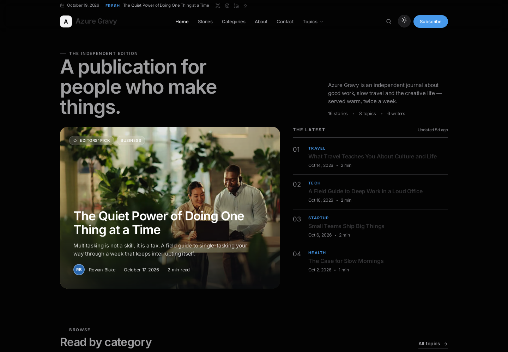
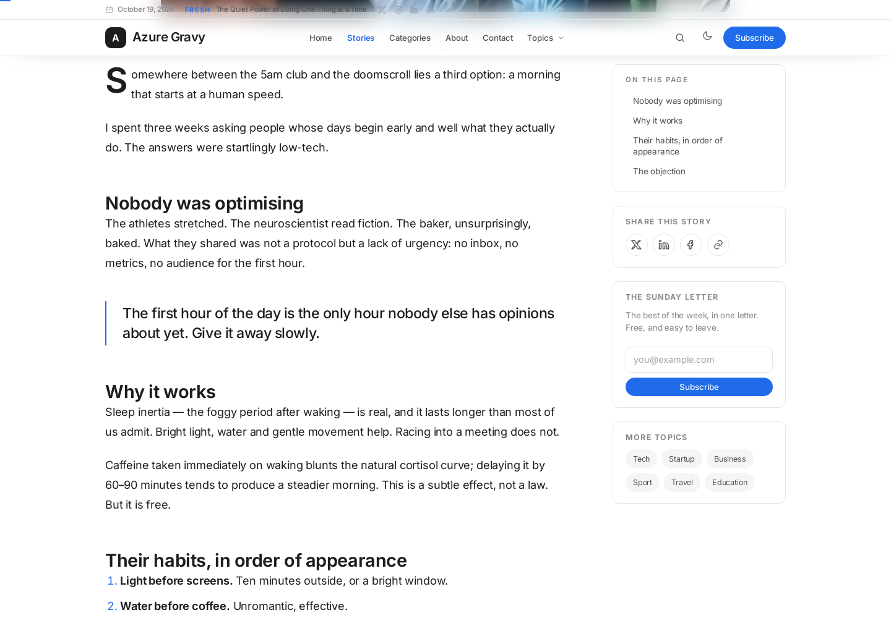
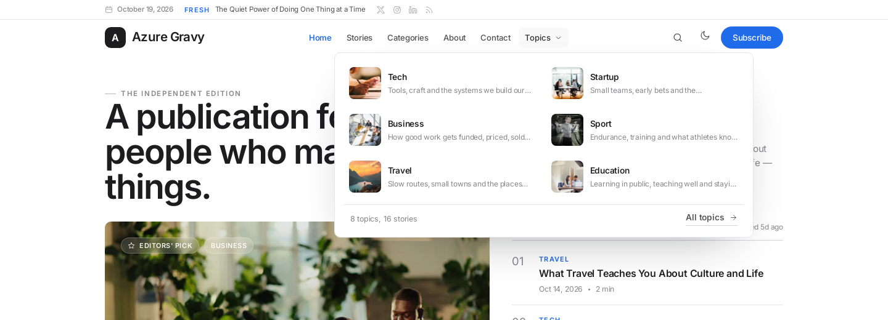
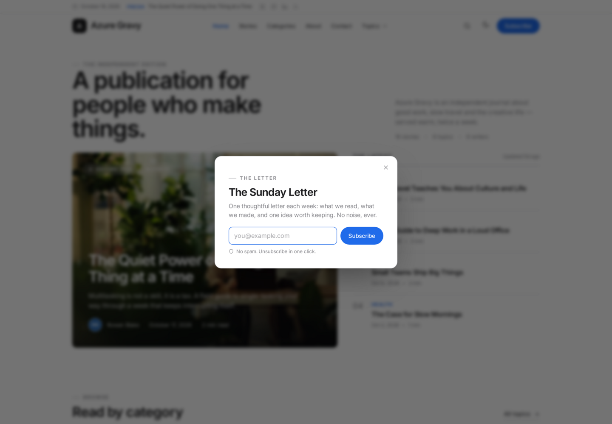
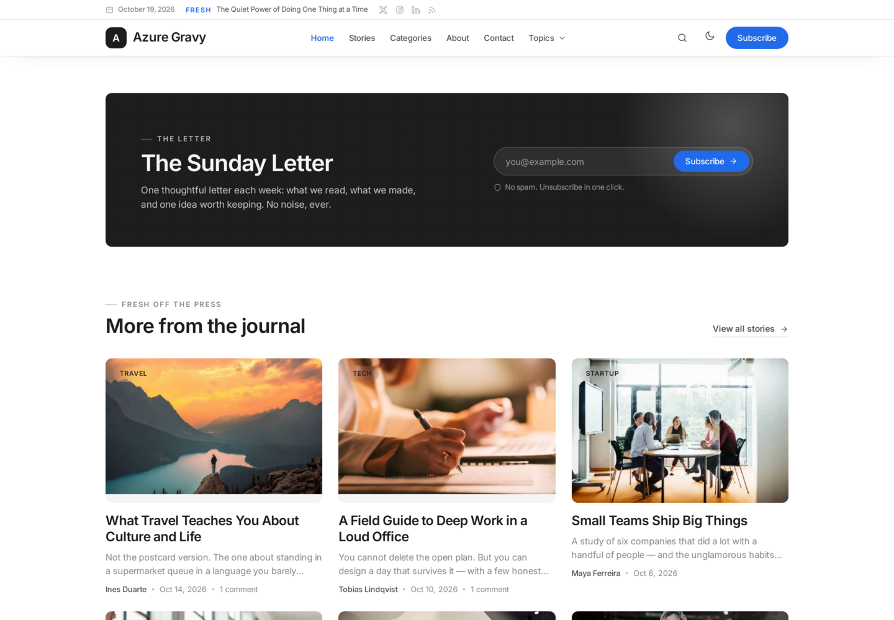
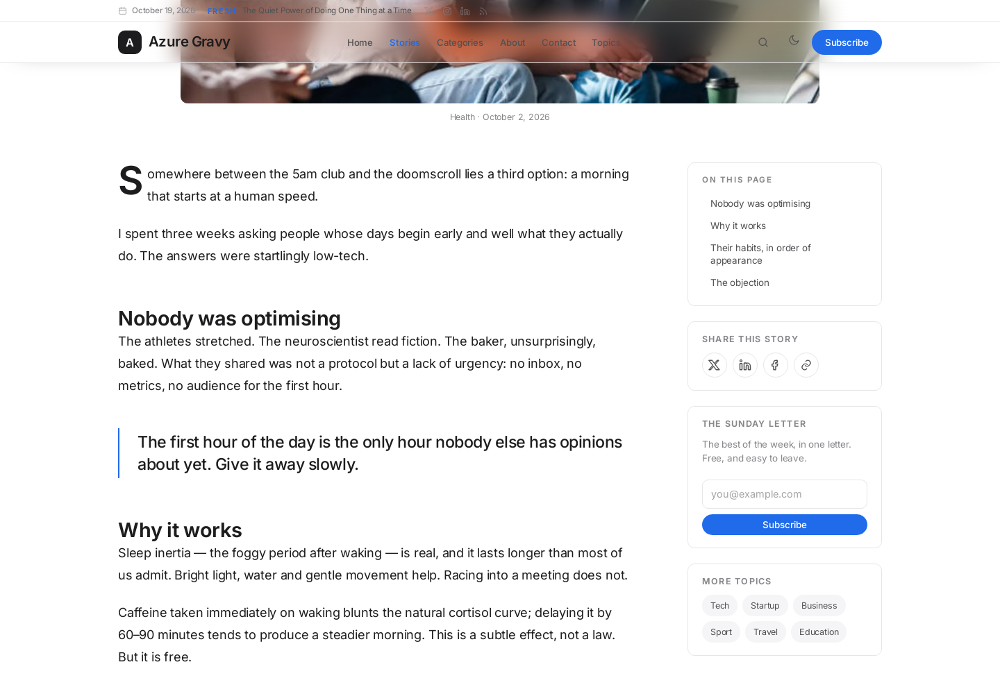
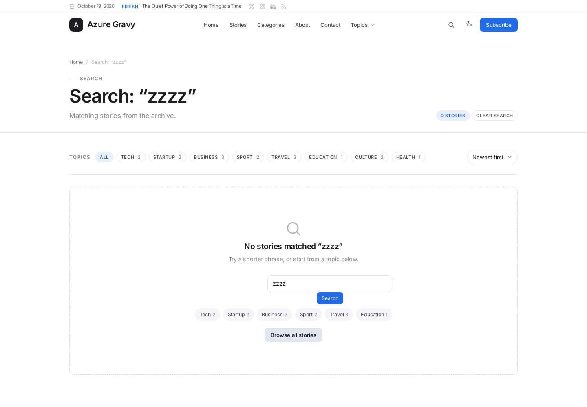
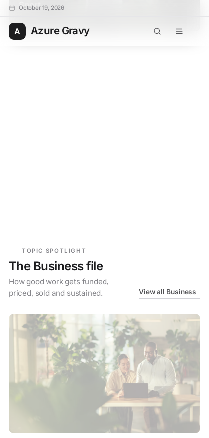

# Azure Gravy CMS

A complete, self-hosted editorial blogging CMS — **Node.js + TypeScript + MariaDB** — with a
magazine-style front end, a full writing studio, and WordPress-class publishing features.

Everything is hand-built: the markup, the design system, the admin UI and the data layer. No CSS
framework, no admin theme, no external JS libraries. Fonts and images ship with the repository, so
the site works with no network access at all.

```
Public site   http://localhost:3000
Studio        http://localhost:3000/admin
Sign in       admin@azuregravy.local / gravy123
```

---

## Quick start

```bash
npm install
cp .env.example .env     # optional — sensible defaults are built in
npm run dev              # http://localhost:3000
```

The first boot creates the schema, runs migrations and seeds a complete demo publication
(18 stories, 4 pages, 8 categories, 42 images, comments, subscribers, menus, redirects and six
users). No database server is required to try it: the default driver runs a real MariaDB engine
embedded inside the Node process.

```bash
npm run dev        # tsx watch, reloads on change
npm run build      # tsc → dist/
npm start          # node dist/server.js (production)
npm run typecheck  # tsc --noEmit
npm run db:seed    # seed an empty database
npm run db:reset   # wipe and reseed — destroys all content
```

### Seeded accounts

| Role   | Email                       | Password   |
| ------ | --------------------------- | ---------- |
| Admin  | `admin@azuregravy.local`    | `gravy123` |
| Editor | `rowan@azuregravy.local`    | `gravy123` |
| Author | `avery@azuregravy.local`    | `gravy123` |

All demo users share the password `gravy123`. Change `ADMIN_EMAIL` / `ADMIN_PASSWORD` in `.env`
before seeding a real installation, and set `SESSION_SECRET` to a long random string.

---

## Database

Two drivers, chosen with `DB_DRIVER`:

| Driver     | What it does                                                                                       |
| ---------- | -------------------------------------------------------------------------------------------------- |
| `embedded` | Runs MariaDB (compiled to WebAssembly) inside Node against `DB_DATA_DIR`. Zero setup, single node. |
| `mysql`    | Connects to an external MariaDB/MySQL server over the wire — use this for production.              |

```bash
# external MariaDB
DB_DRIVER=mysql DB_HOST=127.0.0.1 DB_PORT=3306 \
DB_USER=azuregravy DB_PASSWORD=secret DB_NAME=azuregravy npm start
```

Both drivers sit behind one small interface (`query`, `execute`, `insert`, `transaction`), so the
same code and SQL run on either. Schema creation and versioned migrations happen automatically at
startup. `./data/` and `public/uploads/` are ignored by git.

> The embedded engine is a single-process database: run exactly one app instance against a given
> data directory. Two processes will fight over the same files. For anything with more than one
> instance, use `DB_DRIVER=mysql`.

---

## What's inside

### Writing

- **Split-view markdown editor** — live preview (server-rendered with the same pipeline as the
  front end), toolbar, keyboard shortcuts, word count, and a local autosave snapshot that survives
  a reload or a lost connection.
- **Rich metadata side panel** — status (draft / pending / scheduled / published / private),
  publish date and time, author, categories, tags, featured image, excerpt, custom slug, SEO title
  and meta description, canonical URL, Open Graph image, no-index toggle.
- **Revisions** — every save snapshots the previous body; compare and restore any revision.
- **Trash and restore**, bulk actions (publish, draft, trash, restore), scheduled posts that go live
  on the first request after their publish time, private posts visible only to signed-in staff.
- **Pages** live in the same editor but outside the post stream, with their own templates
  (including a contact page with a working form).
- Categories and tags with descriptions, colours and slug editing; authors pages.
- Slug changes write a **301 redirect** automatically and keep old links alive.

### Media

- Drag-and-drop (or browse) multi-file upload with per-file validation, 12 MB limit, JPEG / PNG /
  WebP / GIF / AVIF.
- Automatic `YYYY/MM` storage, dimensions and file size read on upload, alt text, caption, title.
- Library grid with search and type filters; copy-URL and delete actions; picker modal inside the
  editor that inserts markdown or a featured image without leaving the page.

### Community

- Threaded comments with moderation queue (pending / approved / spam / trash), reply, approve,
  reject, delete, author email + IP recorded.
- Public comment form with honeypot, CSRF protection, markdown escaping and a "your comment is
  awaiting review" state.
- Newsletter subscribers with double-opt-in-style statuses, search, CSV export.
- Contact inbox with read/unread state and reply links.
- Activity log for every editorial action.

### Publication

- **Appearance studio**: wordmark, logo mark, accent colour (six presets plus a colour input),
  default theme (light / dark / system), front-page layout, stories per page, featured slots, and a
  live preview that updates as you type.
- **Settings**: identity, tagline, description, contact email, timezone, date format, reading
  options, discussion rules, newsletter copy, SEO defaults, footer and social links — all persisted
  in the database and read through one settings cache.
- **Navigation builder**: add, reorder, nest and remove header and footer menu items (internal
  links, categories, pages or custom URLs).
- **Redirect manager**: review and delete the 301s created by slug changes.
- **Users and roles** — `admin`, `editor`, `author` with capability checks on every
  route (authors see only their own drafts; only editors can permanently delete; only admins reach
  settings, appearance, people and tools). Profile page with display name, bio, avatar and password
  change.
- **System panel**: database driver, size and table counts, plus maintenance actions — rebuild
  rendered HTML, generate redirects from old titles, prune expired sessions, export the whole
  publication as JSON.

### Front end

- Magazine home page: lead story, editor's picks, topic grid, a **topic spotlight** (one category
  opened up with a lead and a compact list), latest stream, newsletter block.
- **Up next / auto-load**: reaching the end of a story pulls the next piece inline, with the full
  rendered body, so a reader can keep going without a page load.
- **Before you go** bar: a dismissible next-story prompt that slides up past the halfway point and
  remembers the reader's choice per story.
- **Newsletter popup**: opens from every Subscribe button, after 18 seconds, or halfway down the
  page — once per browser, ESC/backdrop to close.
- **Topics mega menu**: image, description and story counts for each category, straight from the
  database.
- Empty states everywhere: a search box, topic chips and a way back instead of a dead end.
- Story page: reading progress bar, sticky share rail, author card, tags, previous/next story,
  related reading, threaded comments.
- Archive, category, tag, author, search and paginated story lists; `/page/2` style pagination.
- Full-text search (title, excerpt, body, tags) with a keyboard-accessible overlay (`/`).
- Dark mode: light / dark / system, remembered per browser, applied before first paint.
- Responsive from 360 px to ultrawide; sticky header, off-canvas admin sidebar on phones.
- SEO: canonical URLs, Open Graph and Twitter cards, JSON-LD `Article` / `BreadcrumbList`,
  `sitemap.xml`, `feed.xml` (RSS 2.0), `robots.txt`, per-post no-index.
- Accessibility: skip link, focus-visible styles, ARIA labels on every icon-only control,
  reduced-motion support, semantic landmarks.

### Security

- Session cookies (HTTP-only, same-site) backed by a MariaDB session store, so restarts keep logins.
- **CSRF token on every mutating request**, including uploads and API routes.
- `scrypt` password hashing with per-user salt and timing-safe comparison.
- Login throttling (six failed attempts per IP + email locks sign-in for 15 minutes), honeypot
  fields on public forms, upload MIME + extension checks, path normalisation for media.
- Output escaping by default (EJS `<%=`), `sanitize-html` on rendered markdown, strict URL
  validation on redirects.
- Friendly 404 / 419 / 500 pages that render without leaking the admin shell.

---

## Project layout

```
src/
  app.ts                 Express app: parsers → session → flash → locals → static → CSRF → routes
  server.ts              boot, migrate, seed-if-empty, listen
  config.ts              env-backed configuration
  db/
    index.ts             DbClient interface, embedded + mysql drivers, transactions, migrations
    schema.ts            schema DDL, migration list, default settings
    seed.ts, seed-data.ts demo publication
  lib/                   markdown, auth, settings, sessions, uploads, http helpers, icons, views
  services/              posts, comments, media, users, stats, activity, navigation
  routes/
    public.ts            home, story, page, archive, category, tag, author, search, feed, sitemap
    admin/*.ts           dashboard, auth, posts, taxonomy, media, comments, people, settings
views/
  layouts/               public, admin, auth, plain (standalone error pages)
  partials/              header, footer, post card, pagination, comment, search overlay, topbar
  public/, admin/        page templates
public/assets/
  css/base.css site.css admin.css
  js/site.js admin.js
  fonts/, seed/          self-hosted fonts and demo images
```

No front-end build step: the CSS and JS are hand-written and served as-is.

---

## Design

The visual language is laid out like a magazine but drawn like Apple.com: one sans-serif display
face (SF Pro on Apple hardware, Inter elsewhere), tight optical letter-spacing, generous white
space, hairline rules and a single accent colour you can change from Appearance.

Buttons follow the Recap demo they were measured against: **8 px corners**, compact 8 × 14 px
padding, 13 px medium label, `#206BEA` fill and a `#3B7DED` hover with a soft 3 px halo. Every
subscribe action — header, mobile drawer, popup, newsletter band, article sidebar — uses the
demo's **32 px pill** (`btn--cta`), while small buttons drop to 6 × 12 px and large ones to
11 × 20 px. The nav keeps no pill at all: the current page is simply accent-coloured text on a
32 px hit area. Cards and media have 10 px corners so photography and buttons agree.
Photography carries the pages — large rounded cards on white or true-black, nothing else competing
for attention.



Both themes are first class. The header toggle cross-fades every surface over ~420 ms (and is
reduced to an instant switch when `prefers-reduced-motion` is set), the choice is remembered per
browser, light/dark/system is the publication default, and the accent colour is expanded server-side
into readable light and dark tints.

Layout and interaction inspiration came from contemporary magazine blogs such as the Recap theme;
all markup, CSS, icons and JavaScript here are original to this project.

---

## Screenshots

| | |
| --- | --- |
| Home |  |
| Story |  |
| Story sidebar |  |
| Stories archive |  |
| Topics |  |
| Topics mega menu |  |
| Newsletter popup |  |
| Newsletter band |  |
| Up next |  |
| Empty search |  |
| Dark mode |  |
| Dashboard |  |
| Editor |  |
| Dark studio |  |
| Appearance |  |
| Mobile |  |
| Mobile spotlight |  |

The rest — sign in, media library, comments, people, subscribers, system, search, archive and the
mobile studio — are in [`docs/screenshots`](docs/screenshots).

---

## Configuration reference

| Variable         | Default                 | Notes                                              |
| ---------------- | ----------------------- | -------------------------------------------------- |
| `PORT`           | `3000`                  | HTTP port, bound to `0.0.0.0`.                     |
| `NODE_ENV`       | `development`           | `production` enables secure cookies in HTTPS setups. |
| `SITE_URL`       | `http://localhost:3000` | Used for canonical links, RSS and the sitemap.     |
| `SESSION_SECRET` | dev fallback            | **Set this in production.**                        |
| `DB_DRIVER`      | `embedded`              | `embedded` or `mysql`.                             |
| `DB_DATA_DIR`    | `./data/mariadb`        | Embedded driver only.                              |
| `DB_HOST/PORT/USER/PASSWORD` | `127.0.0.1:3306 root` | `mysql` driver only.                     |
| `DB_NAME`        | `azuregravy`            | Database name.                                     |
| `ADMIN_EMAIL` / `ADMIN_PASSWORD` | `admin@azuregravy.local` / `gravy123` | Used by the seeder. |

Uploads land in `public/uploads/`; serve that directory (or a CDN in front of it) with the app.

---

## Licence

MIT.
